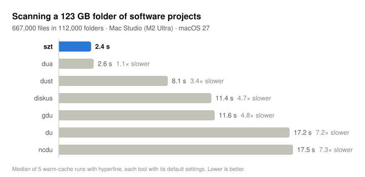

# szt

Find out what's actually taking up your disk space. `szt` (short for sizetree)
scans a folder on several threads and prints a tree of where the bytes are:
biggest first, every folder showing the total of everything inside it,
drilling straight into whatever is big.


That's what it prints for `/Applications`: 33 GB in 447,000 files, sized up
in just over a second. Sizes and bars run from cool to hot by their share of
the total, and the report always fits your window. We like how it looks; maybe
you will too.

It's quick, too: 2.4 seconds for a 123 GB folder of 667,000 files, where `du`
takes 17 (see [Benchmarks](#benchmarks)). More about how it works and how it
compares: [urtti.com/szt](https://urtti.com/szt).

## Install

```sh
brew install urtti/szt/szt
```

The full name adds the urtti/szt tap and tells Homebrew to trust this one
formula from it. Upgrade with `brew update && brew upgrade szt`. Needs macOS 15
or later.

To build it from source instead, with Xcode or the Command Line Tools (Swift 6):

```sh
make install                  # builds and copies to ~/.local/bin/szt
make install PREFIX=/usr/local
```

## Usage

```sh
szt                 # the current folder
szt ~ -n 80         # the 80 biggest things in your home folder
szt ~/Library -d 2  # no more than two levels deep
szt . -m 1G         # only things of 1 GB or more
sudo szt / -X       # the whole startup disk, system volumes too
```

| Option | |
|---|---|
| `-n, --lines N` | Print at most N lines (default: fit the terminal) |
| `--all` | Print every entry |
| `-d, --depth N` | Don't show entries more than N levels down |
| `-m, --min-size SIZE` | Hide entries smaller than SIZE: `500M`, `2G`, `1%` (default `0.1%`; `-m 0` hides nothing) |
| `-a, --apparent` | Count file lengths instead of space used on disk |
| `-b, --binary` | KiB/MiB/GiB instead of Finder's KB/MB/GB |
| `-X, --cross-mounts` | Also scan other volumes mounted inside the path |
| `-j, --threads N` | Scanner threads (default: one per performance core, up to 8) |
| `--color WHEN`, `--no-color` | `auto`, `always` or `never`; `NO_COLOR` is honored |

## How to read it

- Each line is a folder or a file with its **total size**, a bar and its share
  of everything scanned.
- Entries are picked largest-first, and a folder's children only compete once
  the folder itself made the cut. So the tree opens up exactly where the space
  is and stays shut elsewhere.
- `… 3 files, 10 folders` sums up what's left inside a folder after the lines
  shown above it.
- `22k files` after a folder that isn't opened up tells you how many files are
  inside it. Lots of small files (`node_modules`, caches) look very different
  from one huge disk image.
- A folder holding nothing but a single other folder or file is folded into
  one line, like `Toolchains/XcodeDefault.xctoolchain/usr/`, but only when that
  hides no size difference you could see.

## What gets counted

- **Space on disk**, like `du`, not file length. Sparse files (Docker's
  `Docker.raw`, VM disks), APFS-compressed files (most of `/Applications`)
  and cloud files that aren't downloaded count only what they really occupy.
  The summary also shows the apparent size; `-a` sorts by it instead.
- **Hard links** count once.
- **Symlinks** are never followed.
- **Other volumes** mounted inside the path (`/System/Volumes/Data`,
  disk images, network shares) are skipped unless you pass `-X`. Firmlinks
  like `/Users` are followed, so `szt /` counts your data once.
- **iCloud Drive, Dropbox & co.**: scanning never downloads anything.
  Folders that only exist in the cloud are noted, not fetched.
- Folders it can't read are listed at the end. For a complete picture of your
  home folder, give your terminal app Full Disk Access (System Settings ›
  Privacy & Security), or use `sudo` for system folders.

## Benchmarks

<picture>
  <source media="(prefers-color-scheme: dark)" srcset="docs/benchmark-dark.svg">
  
</picture>

Median time of five runs on a Mac Studio (M2 Ultra), every tool with its
default settings, scanning a folder of software projects (123 GB in 667,000
files) and `/Applications` (34 GB in 448,000 files):

| Tool | Projects | /Applications |
|---|--:|--:|
| **szt** | **2.4 s** | **1.0 s** |
| dua | 2.6 s | 1.2 s |
| dust | 8.1 s | 6.9 s |
| diskus | 11.4 s | 7.9 s |
| gdu | 11.6 s | 8.6 s |
| du | 17.2 s | 4.8 s |
| ncdu | 17.5 s | 4.8 s |

The setup, CPU and memory use, and how to run the benchmark on your own Mac
are at [urtti.com/szt](https://urtti.com/szt#benchmarks).

## Why it's fast

- It reads a whole folder in one system call (`getattrlistbulk`): names,
  types and sizes for hundreds of files at once. No file ever needs a call of
  its own.
- One thread per performance core, up to 8, taking work from each other
  whenever one runs out. More threads would only queue up on locks the whole
  kernel shares.
- It only remembers the names of files big enough to show up, so a scan of
  667,000 files fits in 30 MB.

How that was worked out, with profiles and measurements:
[urtti.com/szt](https://urtti.com/szt#why-its-fast).

## License

MIT
